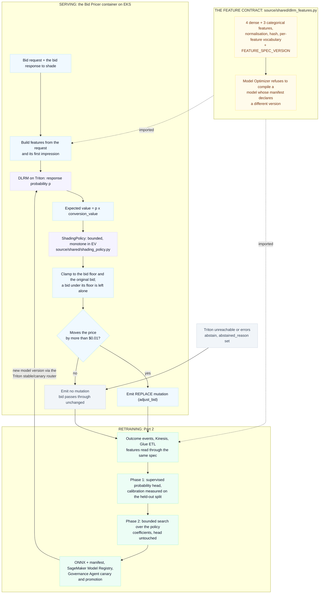
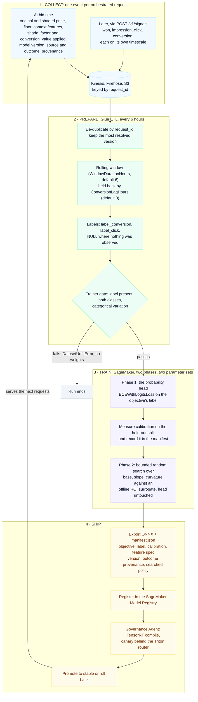

# DLRM Bid Shading

How the Bid Pricer container (`source/containers/dlrm_bid_shader/`, intent `BID_SHADE`) applies the
Deep Learning Recommendation Model to bid shading: what the model predicts, how that prediction
becomes a price, and how the model is retrained.

## What bid shading is, and why a model is involved

In a first-price auction the buyer pays exactly what it bids. A bid at the full value of an
impression wins often and returns nothing; a bid far below it returns well on the few it wins and
loses the rest. Shading is choosing where between those to bid. It is a per-request decision,
because the right answer depends on what this impression is likely to be worth.

That makes it two questions:

1. **How likely is the response the advertiser is paying for?** A prediction about the world.
2. **Given that, how much of its value should we bid?** A decision about strategy.

This guidance answers the first with DLRM and the second with an explicit policy, and keeps them
in separate code and separate parameters.

## The flow



The searched policy coefficients are written into the model manifest. Nothing currently delivers
them to the serving path; see [Known gaps](#known-gaps).

---

## Why DLRM

DLRM is the Deep Learning Recommendation Model of
[Naumov et al., 2019](https://arxiv.org/abs/1906.00091), following
[NVIDIA's DeepLearningExamples](https://github.com/NVIDIA/DeepLearningExamples/tree/master/PyTorch/Recommendation/DLRM)
implementation. Three parts:

1. **A bottom MLP** (4 to 32 to 16) over the continuous features, projecting them to the embedding
   width of 16.
2. **Embedding tables**, one per categorical feature, each sized to its own vocabulary.
3. **An explicit second-order interaction**: the pairwise dot products among the projected dense
   vector and the three categorical embeddings (six terms), concatenated with the dense vector and
   passed to a **top MLP** (22 to 64 to 32 to 1) that ends in a single logit. The export wrapper
   applies the sigmoid, so Triton returns a probability (`ctr_prediction`).

The architecture suits this problem for three reasons.

**The signal lives in combinations.** A domain that converts on one device type and not another,
or a daypart that matters for one country only. DLRM computes those pairwise interactions
explicitly rather than relying on a deep MLP to discover them, which makes it sample efficient on
mixed numeric and categorical data.

**It is the right size for the bid path.** The embedding lookups are gathers and the MLPs are
small. Triton serves it with dynamic batching across concurrent requests.

**The interaction terms are addressable.** Because the pairwise products are computed rather than
implied, a surprising prediction can be attributed to a feature pair.

DLRM here names an architecture and a training recipe. The weights come from this guidance's own
training pipeline. Embedding tables are keyed to a specific feature vocabulary, so weights are not
portable between deployments with different vocabularies.

## The feature contract

**One definition, imported by both the training job and the serving container.**
`source/shared/dlrm_features.py` declares the continuous features and their normalisation, the
categorical features, the hash, and a per-feature vocabulary size. Neither side restates the list,
and `source/tests/test_dlrm_feature_parity.py` asserts both build paths produce the same vector.

| Position | Feature | Encoding |
|---|---|---|
| 0 | `bid_floor` | the impression's floor, raw |
| 1 | `hour_norm` | UTC hour / 24 |
| 2 | `is_weekend` | 1.0 on Saturday or Sunday (UTC) |
| 3 | `has_video` | 1.0 when the impression has a `video` object |
| 4 | `site_domain` | SHA-256 hash into 10,000 slots |
| 5 | `device_type` | SHA-256 hash into 32 slots |
| 6 | `geo_country` | SHA-256 hash into 256 slots |

Slot 0 of every vocabulary is reserved for an absent value, so "missing" is something the model
can learn rather than a hash collision with a real value.

The hash is part of the contract. A categorical value hashed differently lands in a different
embedding slot, so a model trained under one hash scores every value against the wrong row under
another, and nothing fails. Version 1 of the specification hashed with MD5; version 2 uses SHA-256,
matching the Deal Scorer's id hash in `source/shared/ncf_ids.py`. Changing the hash again means
bumping `FEATURE_SPEC_VERSION` and retraining; `source/tests/test_dlrm_feature_parity.py` pins the
algorithm so the test fails before a silent change ships.

The specification carries a `FEATURE_SPEC_VERSION` (currently 2). The trainer writes it into the
`manifest.json` beside each exported model. The Model Optimizer checks it before compiling a
TensorRT engine when the compile request carries `expected_feature_spec_version`, and refuses an
artifact that declares a different version or has no manifest. Matching widths are not treated as
sufficient agreement: two vectors of the same width with different meanings in a position load
cleanly and predict confidently. Both compile paths send the expected version: the deploy-time
genesis compile (`deployment/optimizer-bootstrap.json`) and the retraining promotion path
(`ModelOptimizer` in `source/deployment/model_deployer.py`).

Features are **knowable at bid time**. Three categories are held out by design:

- **The shader's own decisions**: `shade_factor_used`, `conversion_value_estimate_used`, the shaded
  price. A prediction conditioned on the policy that produced its training data cannot be used to
  evaluate a change to that policy.
- **Post-outcome quantities**: ROI, price paid. These are consequences of the bid.
- **Raw user identifiers.** Hashed into a bounded table they carry little signal, and they carry
  privacy obligations that the signal does not justify.

A historical win rate binned by daypart and device would be a useful derived feature. It is not in
the specification, because the serving path has no source for it yet. A feature is in the
specification only if the serving path can obtain it for the request in hand.

## Separating the prediction from the policy

| | The probability head | The policy |
|---|---|---|
| Answers | how likely is the response | how much of the expected value to bid |
| Output | a probability | a price, clamped to the auction's range |
| Trained by | supervised learning on logged outcomes | bounded search against an offline ROI surrogate |
| Changes when | response behaviour changes | strategy or margin target changes |
| Audited by | calibration measurement | monotonicity and bounds, enforced at construction |

The shading arithmetic multiplies the model's output by a currency amount, which is meaningful
only while that output is a probability. An objective defined on bidding outcomes has no term that
rewards calibration, so optimising it over the same parameters would move the output off the
probability scale. The trainer therefore never applies an ROI objective to the network's weights:
its gradient-based phase 2 (`rl_finetune`) finds no policy parameters in the DLRM and skips itself,
and the manifest records `probability_head_frozen_in_phase_2: true`.

## The shading arithmetic

With a predicted probability `p` and a conversion value `v`:

1. **Expected value**: `ev = p × v`. `v` is one value per model, resolved as described under
   [Parameters](#parameters). It is not read per campaign.
2. **Policy**: a bounded, monotone transform of `ev` gives the price the shader is willing to bid.
   A higher expected value never yields a lower bid. The transform is a three-coefficient curve,
   defined once in `source/shared/shading_policy.py`:

   ```
   price = clamp(base + slope × ev ^ curvature, floor, original_bid)
   ```

   `slope` scales expected value into price. `curvature` bends the response: above 1 the shader
   bids proportionally less on low-value impressions and more on high-value ones, below 1 the
   reverse. `base` is a price the policy will not shade beneath. The bounds are `base` in [0, 5],
   `slope` in [0, 3] and `curvature` in [0.2, 2]. A value outside them raises
   `PolicyParameterError` where the policy is constructed rather than being clamped.

   The shipped coefficients are `base=0.0, slope=0.65, curvature=1.0`, which reduce the curve to
   `min(original_bid, ev × 0.65)` floored at the bid floor. `slope` is the same number as the
   `shade_factor` parameter, so a deployment that never sets `base` or `curvature` prices with the
   straight line through the origin.
3. **At or below the original bid.** The clamp caps the price at the bid being shaded. When the
   floor is above the original bid, the clamp returns the floor; the container then emits no
   mutation, because shading only lowers a bid.
4. **At or above the floor.** The floor is the impression's `bidfloor`. For a bid that carries a
   `dealid`, it is the higher of the impression floor and that deal's `bidfloor`.
5. **Material change only.** A shaded price within $0.01 of the original emits no mutation.

The container makes one prediction per request, from the request's first impression, and applies
it to every bid in the response.

## Parameters

`shade_factor` (the policy's `slope`) and `conversion_value` resolve in this order:

1. `model_params` on the request (`ext.model_params`). The UI's sliders and the scenario runs use
   this.
2. The DynamoDB parameter store, read through a cache with a 60-second TTL
   (`PARAMETER_CACHE_TTL`), when the container's pod sets `PARAMETER_STORE_TABLE`. The Adaptive
   Bidding Agent writes `shade_factor` and `conversion_value` there; the deploy seeds them at 0.65
   and 10.0. Values read from the table are clamped to `shade_factor` in [0.3, 0.95] and
   `conversion_value` in [1, 50]. A failed read keeps the last values and is retried after the TTL.
3. The container defaults: `shade_factor=0.65`, `conversion_value=12.0`
   (`DEFAULT_CONVERSION_VALUE` in `source/shared/shading_policy.py`).

`base` and `curvature` come only from `model_params` on the request, and default to the genesis
values.

When Part 2 is deployed, `deploy.sh` sets `PARAMETER_STORE_TABLE` on the Bid Pricer pod and gives
it a service account (`bid-pricer-sa`) with `GetItem` on that table only. With `--no-retraining`
the table does not exist, the variable is empty, and the container skips step 2.

The container reports the `shade_factor` and `conversion_value` it applied in
`metadata.applied_params`, so the outcome event records the values that priced the bid.

## Training data

**The orchestrator emits one outcome event per request it serves** (`emit_bid_outcome` in
`source/orchestrator/feedback_integration.py`), fire-and-forget through Kinesis, off the critical
path. The event carries:

- the bid's original price from the bid response, and its shaded price (the original price when
  the shader left the bid alone);
- the floor and the context fields the feature spec reads;
- the `shade_factor` and `conversion_value` the shader reported applying, and the model version it
  reported (`unknown` when the shader did not run);
- a `source` of `live` or `load_test`, and an `outcome_provenance` of `unresolved`, `simulated` or
  `observed`.

A bid priced below its floor cannot trade, so it produces no event.

**Outcomes arrive later and on different timescales.** At bid time the outcome fields are NULL.
Win, impression, click and conversion signals arrive through `POST /v1/signals`, and the
`SignalAssociator` re-emits the event enriched. The Glue ETL de-duplicates by `request_id`, keeping
the most resolved version. It processes a rolling window (`WindowDurationHours`, default 6) held
back by `ConversionLagHours` (default 0), so a deployment whose conversions lag must set that
parameter to the lag of its objective. A window shorter than the lag under-counts positives.

**Origin is recorded.** The load-test path and the optional outcome simulator mark their events
`simulated`. The trainer writes the provenance mix of its dataset into the manifest, so a model
trained on simulated outcomes is identifiable as one.

**The label is the response the advertiser pays for**, selected by the `objective`
hyperparameter: `cpa` (the default) trains on `label_conversion`, `cpc` on `label_click`. The
objective and label column are recorded in the manifest. A third objective, `profitable_win`,
trains on the legacy `label` column and is kept for comparison with older models only. It folds the
price paid into the label, so multiplying its output by a conversion value does not give an
expected value.

**The dataset is gated before training.** The job ends with a named `DatasetUnfitError`, and no
weights, when the label column is missing, no row is labelled, the labelled rows contain only one
class, or a categorical column has a single distinct value or a distinct value on every row.
Unlabelled rows are dropped rather than read as negatives.

## Training procedure

The retraining loop end to end:



The SageMaker training container (`source/training/container/train.py`) runs:

1. **Gate** the dataset as above.
2. **Fit the probability head** with `BCEWithLogitsLoss`, holding out the last
   `validation_split` (default 10%) of rows. Measure calibration on that split (expected calibration
   error and per-bin gaps) and record it in the manifest.
3. **Search the policy coefficients**: 512 random candidates inside the bounds (fixed seed), scored
   against an offline surrogate on won rows with a recorded `price_paid`. A candidate wins a row
   when its price is at or above the recorded clearing price, and scores the observed conversion
   value minus its price. Lost rows are not scored, because nothing records what would have won
   them. Each row's expected value uses the `conversion_value_estimate_used` recorded on its
   outcome event, or `DEFAULT_CONVERSION_VALUE` for rows without it. The best candidate is kept
   only if it beats the genesis policy; otherwise the manifest records the genesis policy. The
   manifest labels the method `offline_surrogate`, because the score is not a measured lift.
4. **Export** the serving signature to ONNX with `manifest.json` beside it, and register the model
   package in the SageMaker Model Registry. The manifest records `feature_spec_version`, which the
   promotion compile checks.
5. **Promote** through the Governance Agent: the Model Optimizer compiles a TensorRT engine, the
   Canary Deployer stages it as `dlrm_bid_shader_canary` behind the Triton router at 5% of live
   traffic (or 0% when it is staged for a load-test comparison), the agent compares it with
   stable, and promotes it or rolls it back.

## What the response carries

- The `adjust_bid` mutations, or none.
- `metadata.model_version`: the version the Triton router reports for this request (stable or
  canary), or the static `dlrm-nvidia-triton-v1` when the router has not resolved one.
- `metadata.applied_params`: the `shade_factor` and `conversion_value` that priced the bids, which
  the outcome event records.
- `metadata.abstained_reason` when the container could not get a prediction.

The calibration measurement, feature spec version, objective and searched policy are in the
model's manifest, not in the response.

## Abstention

When Triton is unreachable or returns an error, the shader emits no mutation and sets
`abstained_reason` to `inference_unavailable: <detail>`. The bid proceeds at the price the bidder
set. The readiness warm-up treats an abstention as not ready, so a pod that cannot reach Triton
does not report ready.

Shading needs an estimate of value. Without one there is no basis for moving a price, and a
substituted value would produce a real price change from a number that was never a prediction.

## Known gaps

- **The searched policy does not reach serving.** The trainer records the searched `base`, `slope`
  and `curvature` in the manifest. Nothing writes them to the parameter store, which carries only
  `shade_factor` and `conversion_value`, so a deployed shader uses the genesis `base` and
  `curvature` unless the request sets them.
- **A promotion needs a second GPU node.** A retrained model's TensorRT compile runs as a
  Kubernetes Job that requests one GPU. Triton holds the only GPU of the default single node, and
  the cluster has no autoscaler, so the Job stays Pending and fails at its 30-minute deadline.
  Scale the `gpu-inference` node group to 2 while a promotion runs, then back to 1.

## References

- Naumov et al., *Deep Learning Recommendation Model for Personalization and Recommendation Systems*,
  [arXiv:1906.00091](https://arxiv.org/abs/1906.00091)
- [NVIDIA DeepLearningExamples: DLRM for PyTorch](https://github.com/NVIDIA/DeepLearningExamples/tree/master/PyTorch/Recommendation/DLRM)
- [torchrec](https://github.com/pytorch/torchrec): `torchrec.models.dlrm.DLRM`
