# Guidance for Accelerator-Optimized Agentic Bidding on AWS, Part 2

**Category:** Advertising &amp; Marketing Technology
**Industry:** Advertising, Media &amp; Entertainment
**Products:** Amazon Bedrock AgentCore, Amazon Bedrock, Amazon SageMaker, AWS Glue, Amazon Kinesis, Amazon EventBridge, Amazon DynamoDB, NVIDIA TensorRT, NVIDIA Triton Inference Server, NVIDIA NeMo Framework
**Published:** October 2026

## Overview

Part 1 of this Guidance runs IAB Tech Lab ARTF (Agentic Real Time Framework) containers on Amazon EKS that make real-time bidding decisions with models served by NVIDIA Triton Inference Server. Those models ship with fixed weights: the bid pricer (DLRM) uses seeded initial weights, the deal scorer (NCF) is trained at deploy time on sample interactions generated from the deal book, and the two yield optimizer models (XGBoost) are genesis exports. Nothing in Part 1 changes them after deployment.

Part 2 closes the loop. It records the outcome of each decision, turns those outcomes into labeled training data, retrains and evaluates new model versions, and promotes or rejects them without modifying the ARTF containers. It also adds an AI agent that tunes bid-shading parameters from live market metrics. Three loops work together:

1. **Batch retraining loop.** Bid outcomes and deal-yield outcomes flow through Amazon Kinesis and Amazon Data Firehose into Amazon S3. Two AWS Glue jobs label them. A daily Amazon EventBridge Scheduler trigger starts Amazon SageMaker training jobs: a PyTorch trainer packaged on the NVIDIA NeMo Framework container for the bid pricer, and SageMaker's built-in XGBoost for the yield optimizer's floor and margin models. Each completed job is registered as a new version in the SageMaker Model Registry.
2. **Governance loop.** A new registered version triggers the Model Promotion Governance Agent. It compiles the ONNX artifact to a TensorRT engine, stages it as a canary behind the Triton router the ARTF containers already call, runs an A/B test (Welch's t-test with SPRT early stopping), and promotes, rejects, or rolls back. Each decision is written to an append-only audit trail.
3. **Agentic parameter-tuning loop.** A Bedrock reasoning agent reads bid-outcome metrics from Amazon CloudWatch once every 24 hours by default and decides whether to adjust `shade_factor` and `conversion_value`. The parameter store, not the agent, enforces hard bounds on every write.

> **Note for the reader:** This document covers Part 2 only. See [GUIDANCE.md](GUIDANCE.md) for Part 1: the ARTF containers, the orchestrator's staged pipeline, and the Triton serving layer. Part 1 already serves the bid pricer and deal scorer as TensorRT plans behind a stable/canary router, plus the two XGBoost models on Triton's FIL backend. Part 2 deploys alongside that path and does not modify it. For the how-to (deploying, trying it, pausing schedules) see [CLOSED_LOOP.md](CLOSED_LOOP.md).

## Use Cases

1. **Model improvement from recorded outcomes:** Retrain the bid pricer and yield optimizer models on recorded win, loss, price, and response data rather than a one-time export.
2. **Safe model promotion:** Validate each retrained version against the incumbent with a live canary and a statistical A/B test before it serves all traffic, with automatic rollback on latency or error-rate regression.
3. **Adaptive bid pricing:** Tune the bid-shading parameters that convert a predicted response probability into a shaded bid price, based on the platform's win rate and ROI.
4. **Governed, auditable ML operations:** Give every promotion, rejection, and parameter change a durable, queryable audit record, including the rationale the agent generated.
5. **Zero-downtime model rollout:** Roll out a new model version without a deployment, a restart, or any change to the ARTF containers.

## Business Benefits

| Benefit | Description |
|---------|-------------|
| Models track the market | Retraining on recorded outcomes keeps models from drifting away from current conditions |
| Reduced operational risk | Every promotion passes an automated statistical gate and guardrail monitoring before it can affect live spend |
| Faster response to market shifts | An agent re-tunes bid pricing on a schedule (daily by default, adjustable down to minutes) instead of waiting for a manual review |
| Auditability | Every parameter change and promotion decision is recorded with its reason, supporting compliance and post-incident review |

## Technical Benefits

| Benefit | Description |
|---------|-------------|
| No new dependency in the bidstream | Canary routing happens inside Triton; the split is set at model load, not looked up per request |
| Statistical promotion gate | Welch's t-test and the sequential probability ratio test (SPRT) decide whether a challenger outperforms the incumbent |
| Automatic guardrail rollback | A canary whose p99 latency exceeds 1.2 times the stable version's, or whose error rate exceeds 1%, is rolled back within a 60-second detection-to-rollback budget |
| On-demand GPU use for optimization | TensorRT compilation runs as one-shot Kubernetes Jobs, so Triton stays the only steady-state GPU consumer |
| Reasoning over recorded telemetry | The Adaptive Bidding agent reasons over CloudWatch metrics; the Governance agent's rationale is generated from the decision and metrics its pipeline produced and cannot override that decision |
| Dataset gate before training | The trainer refuses a dataset with no label column, no labelled rows, a single class, or a constant categorical, and ends the job with that diagnosis |
| Least-privilege agent execution | Each AgentCore runtime has its own IAM execution role, with a trust policy scoped to the runtime-name prefix |

## How It Works

### The Three Loops

**1. Batch retraining loop.** The orchestrator emits a bid outcome event for each bid-shading decision to a Kinesis Data Stream. Firehose buffers the events (300 seconds by default) and writes Parquet to an S3 raw-outcomes bucket cataloged as `<p>_feedback_pipeline.raw_bid_outcomes`. A Glue job runs every 6 hours, de-duplicates by `request_id`, engineers features (ROI, `shade_ratio`, a bucketed win rate), carries each row's `outcome_provenance` (`unresolved`, `simulated`, or `observed`), and writes labeled Parquet to a KMS-encrypted training-data bucket. The conversion lag (`ConversionLagHours`, default 0) holds the window back so late responses can arrive, and decides when a missing response becomes a negative label.

Once every 24 hours, EventBridge Scheduler invokes a Lambda function that resolves the latest **Approved** version of each of the four models and starts one SageMaker training job per model. Genesis versions are registered as Approved at deploy time, so jobs start from the first day. For the bid pricer, the job fits the probability head by supervised learning, reports calibration on a held-out split, and then searches the shading policy's coefficients with the probability head frozen. The gradient-based reinforcement step is skipped for this model, because the network has no policy parameters. The job exports ONNX and a manifest recording the objective, the dataset measurements, and the outcome provenance mix.

The deal scorer's scheduled job reads the same bid-outcome dataset, which carries no `user_id` or `deal_id`, so it stops at the dataset gate. The deal scorer is trained only at deploy time, on sample interactions, until those columns are added to the outcome schema and the ETL.

When a job completes, an EventBridge rule invokes a registration Lambda that records the version in its Model Package Group as `PendingManualApproval` and emits a `ModelPackageGroupChanged` event for governance.

The yield optimizer's floor and margin models use a separate path, because a deal floor or margin adjustment has no bid price to shade and produces a different event shape: a second stream, Firehose delivery stream, S3 prefix, and Glue table (`raw_deal_yield_outcomes`) carry `DealYieldOutcomeEvent` records. A second Glue job de-duplicates by `(request_id, deal_id, intent)`, since one deal can carry both a floor and a margin mutation, and writes two labeled datasets, one per model. Triton's FIL backend does not support multi-output regression, so floor and margin are separate single-target XGBoost models trained with SageMaker's built-in XGBoost container.

No live win/loss signal for deal-level decisions is wired in yet, so this path learns from two labelled sources:

- **Load-test traffic.** Load tests against a yield container emit outcome events tagged `source=load_test`, with an outcome computed by the load test's own buyer model.
- **Bounded exploration.** With probability `YIELD_EXPLORATION_EPSILON` (0.1 in the shipped manifests), the container perturbs its prediction by a small bounded amount, which lets a model that has converged to "no change" still produce mutations to learn from. Exploration applies only to load-test requests and to requests that set `ext.model_params.explore`; other traffic always gets the unperturbed prediction. Each explored response carries a `:explore` suffix on its `model_version`, so training data can separate probes from the model's own recommendations.

**2. Governance loop.** A `ModelPackageGroupChanged` event invokes the Model Promotion Governance Agent (an AgentCore runtime) through a shim Lambda. For a scheduled retraining version, the agent: (a) compiles the ONNX artifact to a TensorRT engine with the on-demand Model Optimizer, (b) stages the engine as a canary at 5% of traffic through the Triton router, (c) runs an A/B test on per-variant CloudWatch metrics (primary metric `revenue_per_bid`, at least 100 samples, significance 0.05, up to 4 hours), and (d) promotes, rejects, or declares the test inconclusive. Promotion publishes the canary as a new stable version; rejection, an inconclusive result, or a guardrail breach rolls back to the incumbent. The agent updates the registry status and writes the decision and metrics to the DynamoDB audit trail.

A TensorRT-served version trained from the Governance page's **Train from load test** action follows a shorter path: the agent compiles it and stages it as the challenger canary at 0% live traffic, then stops. The operator compares challenger and stable with a seeded load test and promotes manually; the registry status stays `PendingManualApproval` until then.

**3. Agentic parameter-tuning loop.** Once every 24 hours by default, EventBridge Scheduler invokes a Lambda function that calls the Adaptive Bidding Strategy Agent (an AgentCore runtime). The agent reads win rate, ROI, prices paid, and sample counts from the `ARTF/BidOutcome` CloudWatch namespace, reads the current parameters from the DynamoDB parameter store, and asks a Bedrock model whether to adjust them. If the Bedrock model is unavailable, the invocation fails rather than falling back to a formula. Every write is checked against hard bounds (`shade_factor` 0.3 to 0.95, `conversion_value` 1.0 to 50.0), a maximum change per update (0.05 and 2.5), and an optimistic-concurrency version check, all enforced by the parameter store.

The bid pricer container can read these parameters at inference time through a 60-second in-process cache, but only when its pod sets `PARAMETER_STORE_TABLE`. The shipped bid-pricer manifest (`deployment/eks/artf-containers-deployment.yaml`) does not set it, so the deployed container uses its built-in defaults (`shade_factor` 0.65, `conversion_value` 12.0) unless a request overrides them.

### Architecture



### Model Serving: TensorRT Engines and Live Canary Routing

**Model Optimizer (on demand, not a stock NIM).** Engine compilation is done by an in-cluster Model Optimizer built on `nvcr.io/nvidia/tensorrt:24.08-py3`, which runs `trtexec` on a GPU node to compile an ONNX artifact into a `model.plan`. It runs as one-shot Kubernetes Jobs rather than a service: a deploy-time bootstrap Job builds the base engines in Phase 3 and exits, and each promotion launches its own optimize Job. FP16 is the default precision. INT8 is refused with HTTP 400 unless a calibration cache is supplied. No stock NVIDIA NIM exists for these custom DLRM and NCF architectures; TensorRT is the engine a NIM is built on.

**Live canary through the Triton router.** Each recommender model name the ARTF containers call (`dlrm_bid_shader`, `ncf_deal_manager`) is a Triton Python-backend router. It forwards each request to `<model>_stable` or `<model>_canary`, both `tensorrt_plan` models, using a traffic-split percentage read when the router loads. Changing the split is a control-plane action: the deployer edits the router's configuration in the S3 model repository and Triton reloads it in poll mode. Staging writes the canary engine and sets the split; promotion publishes the engine as a new `<model>_stable` version, waits for it to be ready, zeroes the split, and removes the canary; rollback zeroes the split and removes the canary.

The yield optimizer's FIL models have no router. A retrained floor or margin version can be staged as `<model>_canary` beside the served model (no compile step, since FIL loads `xgboost.json` directly) so a challenger load test can target it, but no live traffic is split to it.

**Governance runtime networking.** The Governance Agent runs as a public AgentCore runtime and reaches the cluster through a VPC-attached proxy Lambda (`<p>-vpc-optimizer-proxy`, 900-second timeout, 256 MB). Triton readiness and model-control calls go to an internal Network Load Balancer; an optimize request makes the Lambda launch a one-shot optimizer Job through the Kubernetes API and return the engine URI. The Lambda's IAM role maps to the Kubernetes group `optimizer-job-launcher`, bound to a namespaced Role that can create, read, watch, and delete Jobs and read Pods and their logs in the Job namespace only.

### Governance Decision Pipeline

| Stage | Action | Outcome on failure |
|-------|--------|---------------------|
| 1. Model optimization | Compile the ONNX version to a TensorRT engine | Reject with reason; no canary is staged |
| 2. Canary deployment | Stage the engine, confirm Triton loads it, route initial traffic (default 5%) | Reject with reason; canary removed |
| 3. A/B evaluation | Collect per-variant metrics; evaluate with Welch's t-test and SPRT against the significance level and guardrail metrics | Keep evaluating until promote, reject, or maximum duration |
| 4a. Promote | Publish the canary as the new stable version, confirm it is ready, zero the split, remove the canary | n/a |
| 4b. Reject | Guardrail breach, or the challenger significantly underperforms; roll back | n/a |
| 4c. Inconclusive | Maximum duration reached without significance; roll back | n/a |
| 5. Registry update | Set the Model Registry approval status (`Approved` or `Rejected`) | n/a |
| 6. Audit record | Write the decision, reason, and metrics snapshot to the audit trail | n/a |

### Guardrail Monitoring

While a canary serves traffic, a guardrail monitor polls CloudWatch every 10 seconds over a 60-second window and compares the canary with the stable version:

| Guardrail | Threshold | Action on breach |
|-----------|-----------|-------------------|
| p99 latency | Canary p99 exceeds 1.2 times the stable version's p99 | Automatic rollback within 60 seconds of detection; audit record written |
| Error rate | Canary error rate exceeds 1% | Automatic rollback within 60 seconds of detection; audit record written |

### AWS Services in This Guidance (Part 2)

| AWS Service | Role in This Guidance |
|-------------|------------------------|
| Amazon Bedrock AgentCore | Hosts the Adaptive Bidding Strategy Agent and the Model Promotion Governance Agent |
| Amazon Bedrock | Foundation model for both agents (default: the `global.anthropic.claude-opus-4-8` cross-region inference profile) |
| Amazon SageMaker | Training jobs for the bid pricer (NeMo Framework-based training image) and the yield optimizer (built-in XGBoost); Model Registry with one Model Package Group per model |
| Amazon Kinesis Data Streams and Amazon Data Firehose | Capture bid outcomes and deal-yield outcomes and deliver them to S3 as Parquet |
| AWS Glue | Data Catalog tables for raw outcomes; two ETL jobs every 6 hours that de-duplicate and label outcomes |
| Amazon EventBridge (Scheduler and rules) | Daily agent and retraining schedules; rules on training-job completion and model registration |
| AWS Lambda | Invocation shims between EventBridge and AgentCore, the retraining trigger and registration functions, and the VPC-attached proxy for the Governance runtime |
| Amazon DynamoDB | Parameter store, append-only audit trail, and user-features table, encrypted with AWS KMS |
| AWS KMS | One customer-managed key for the tables, the SNS topic, and the training-data bucket |
| Amazon CloudWatch | Bid-outcome metrics, per-variant inference metrics, and guardrail queries |
| Amazon S3 | Raw outcomes, labeled training data, Glue scripts, ONNX sources, and staged and served Triton models |
| Amazon EKS | Runs the on-demand Model Optimizer Jobs and Triton, on the Part 1 cluster |
| Amazon VPC | Private subnets the proxy Lambda attaches to |
| AWS IAM | Per-agent execution roles with runtime-name-prefix trust, a manual-override role, and the proxy Lambda's namespaced RBAC mapping |
| Amazon SNS | Training-failure alerts on a KMS-encrypted topic |
| Amazon ECR | The training image (shared repository `artf-nemo-rl-training`) and both agent runtime images |
| AWS Secrets Manager | The NVIDIA NGC API key used to pull the NeMo Framework base image |

### NVIDIA Acceleration and Integration Components (Part 2)

| Component | Version | Purpose |
|-----------|---------|---------|
| NVIDIA TensorRT (Model Optimizer) | `nvcr.io/nvidia/tensorrt:24.08-py3`, `trtexec` | Compiles ONNX artifacts into `tensorrt_plan` engines on demand |
| NVIDIA NeMo Framework | `nvcr.io/nvidia/nemo:24.07` base image | CUDA and PyTorch runtime for the bid pricer's SageMaker training image |
| NVIDIA Triton canary router | Python backend, in cluster | Splits inference traffic between stable and canary TensorRT versions |
| NVIDIA Triton FIL backend | Triton 24.08 | Serves the floor and margin XGBoost models from native `xgboost.json` |

## Well-Architected Pillars

### Operational Excellence

- **Infrastructure as code:** `deploy_closed_loop.sh`, run by `deploy.sh` in Phase 5, provisions the feedback pipeline, Glue jobs, tables, Model Registry groups, IAM roles, both AgentCore runtimes, and the EventBridge invocation paths in dependency order
- **Idempotent deployment:** Re-running reuses existing stacks, seeds the parameter store and genesis versions only if absent, and rebuilds the training image only when the hash of its source changes
- **Observability:** Every governance decision and parameter change produces an audit record; Triton exposes per-variant metrics; CloudWatch records agent invocations and bid outcomes
- **Model provenance:** Each trained artifact carries a manifest with its objective, dataset measurements, calibration, and outcome provenance mix

### Security

- **Least privilege:** Each AgentCore runtime has its own execution role scoped to the tables, S3 prefixes, and CloudWatch namespaces it uses; trust policies are scoped by runtime-name prefix so roles exist before the runtimes do
- **No direct network exposure for cluster internals:** The Governance runtime reaches internal endpoints only through the VPC-attached proxy Lambda, whose Kubernetes access is limited to Jobs and Pods in one namespace
- **Encryption at rest:** Every Part 2 DynamoDB table, the SNS topic, and the training-data bucket are encrypted with AWS KMS
- **Manual override gating:** The manual-override role requires the `governance:ApproveModel` permission and an external ID condition

### Reliability

- **Automatic rollback:** A canary that breaches a guardrail is rolled back within 60 seconds without operator action
- **No serving gap during promotion:** The incumbent stays loaded until the new stable version reports ready
- **Explicit failure:** The optimizer, both agents, and the trainer fail with a stated reason instead of substituting a result: INT8 without a calibration cache is refused, an unreachable Bedrock model raises, and an unfit dataset ends the training job before phase 1
- **Cold-start safety:** Raw-outcome prefixes are created at deploy time so the first scheduled Glue run reads zero rows instead of failing

### Performance Efficiency

- **On-demand GPU use for optimization:** TensorRT compilation runs as one-shot Jobs, so the GPU node group's steady-state footprint is unchanged from Part 1
- **In-process canary routing:** The router splits traffic inside Triton, with no per-request lookup
- **Cached parameter reads:** The bid pricer's parameter client caches values for 60 seconds in front of DynamoDB when it is configured; no DynamoDB Accelerator (DAX) cluster is deployed, and the client uses DAX only if `DAX_ENDPOINT` is set

### Cost Optimization

- **No always-on optimizer GPU:** Optimization runs only when a version is promoted or bootstrapped
- **Consumption-billed agents:** Both AgentCore runtimes and the Lambda shims incur cost only when invoked
- **Pausable schedules:** The agent and retraining schedules can be disabled without a teardown (see [Pausing scheduled components](#pausing-scheduled-components))
- **Early exit on unfit data:** A training job with missing or unfit data ends at the dataset gate after a few billable minutes

### Sustainability

- **Shared GPU capacity:** Optimizer Jobs use the GPU node group Triton already runs on
- **Event-driven compute:** Lambda functions, optimizer Jobs, and training jobs run only in response to events or schedules

## Plan Your Deployment

### Prerequisites

- The Part 1 prerequisites (see [GUIDANCE.md](GUIDANCE.md)); Part 2 runs on the same EKS cluster
- Permissions to create Amazon Bedrock AgentCore runtimes, SageMaker training jobs and Model Package Groups, Kinesis streams, Firehose delivery streams, Glue jobs, EventBridge schedules and rules, DynamoDB tables, Lambda functions, KMS keys, SNS topics, and IAM roles
- Access to an Amazon Bedrock model or inference profile in the target account and Region (default: `global.anthropic.claude-opus-4-8`)
- An NVIDIA NGC API key to pull the gated `nvcr.io/nvidia/nemo` base image for the training container

### Supported Regions

Part 2 can be deployed in any AWS Region that supports Amazon Bedrock AgentCore, Amazon SageMaker, AWS Glue, and the Part 1 prerequisites (Amazon EKS and NVIDIA A10G `g5` instances). Confirm AgentCore availability first; it has a smaller regional footprint than the other services. `deploy.sh` defaults the agents' model to the `global.anthropic.claude-opus-4-8` cross-region inference profile; `--model-id` (or `BEDROCK_MODEL_ID`, and per agent `ADAPTIVE_BIDDING_MODEL_ID` or `GOVERNANCE_MODEL_ID`) overrides it. Run standalone, `deploy_closed_loop.sh` has no default and requires one of these variables.

### Deployment Steps

Part 2 is part of the default `deploy.sh` run (`--with-retraining` is the default; `--no-retraining` turns it off). Pass the NGC key once per prefix:

```bash
cd deployment
./deploy.sh --prefix dv1 --ngc-key YOUR_NGC_API_KEY
```

`deploy.sh` runs in five phases. Part 2 touches three of them:

| Phase | Part 2 work |
|-------|-------------|
| 1/5 Preparing models | Exports the DLRM to ONNX, trains and gates the NCF on sample interactions, and exports the genesis XGBoost floor and margin models; uploads the ONNX sources, the router, stable, and FIL model configurations, and the optimizer bootstrap spec to the S3 model repository |
| 3/5 Deploying workloads | Starts the one-shot TensorRT base-engine bootstrap Job (non-blocking); Triton loads the engines from S3 when it finishes |
| 5/5 Registering agents | Runs `deploy_closed_loop.sh` (below) |

To deploy Part 2 against an existing Part 1 stack:

```bash
cd deployment
./deploy_closed_loop.sh --prefix dv1
```

`deploy_closed_loop.sh` provisions the stack in dependency order. Every resource name starts with the prefix except the shared training image repository `artf-nemo-rl-training` (step 4):

| Step | Action | Resources created (defaults) |
|------|--------|-------------------------------|
| 1 | Feedback pipeline | Stack `<p>-feedback-pipeline`: KMS key; Kinesis Data Streams `<p>-bid-outcome-stream` and `<p>-deal-yield-outcome-stream` (provisioned, 2 shards each); Firehose `<p>-bid-outcome-delivery` and `<p>-deal-yield-outcome-delivery` (300 s buffer); S3 `<p>-raw-outcomes-<account>-<region>`; Glue database `<p>_feedback_pipeline` |
| 2 | Glue ETL | Stack `<p>-glue-etl`: S3 `<p>-training-data-<account>-<region>`; jobs `<p>-feature-engineering-etl` and `<p>-deal-yield-feature-engineering-etl` (Glue 4.0, 10 G.1X workers, 120-minute timeout) on `cron(0 */6 * * ? *)`; scripts bucket `<p>-artf-scripts-<account>` |
| 3 | Closed-loop core | Stack `<p>-closed-loop-core`: DynamoDB `<p>-parameter-store`, `<p>-audit-trail`, `<p>-user-features` (on-demand); Model Package Groups `<p>-artf-dlrm-bid-shader`, `<p>-artf-ncf-deal-manager`, `<p>-artf-deal-yield-manager-floor`, `<p>-artf-deal-yield-manager-margin`, each seeded with an Approved genesis version; SNS `<p>-training-alerts` |
| 4 | Agent roles and training image | Stack `<p>-agentcore-security`; parameter store seeded; training image built into the shared, unprefixed ECR repository `artf-nemo-rl-training` (CodeBuild, asynchronous, by default) |
| 5 | AgentCore runtimes | `<p>_AdaptiveBiddingStrategyAgent` and `<p>_ModelPromotionGovernanceAgent` (HTTP protocol, arm64 images built locally when Docker can build, otherwise in CodeBuild); stack `<p>-vpc-proxy` with Lambda `<p>-vpc-optimizer-proxy` and its RBAC mapping |
| 6 | Invocation paths | Stack `<p>-governance-eventbridge`: schedules `<p>-adaptive-bidding-scheduler` and `<p>-retraining-scheduler`, both `rate(24 hours)`; the retraining trigger starts up to 4 SageMaker jobs on `ml.g5.2xlarge` (100 GB volume, 4-hour maximum); rules `<p>-retraining-job-completed` and `<p>-governance-model-registered` |
| 7 | Frontend rewire | Rebuilds the React app with the agent runtime ARNs |

Useful options:

```bash
./deploy_closed_loop.sh --prefix dv1 --skip-agentcore   # infrastructure only, no agent runtimes
./deploy_closed_loop.sh --prefix dv1 --stack-only       # CloudFormation stacks only
./deploy_closed_loop.sh --prefix dv1 --local-build      # build the training image locally (default: --remote-build on CodeBuild)
AWS_REGION=us-west-2 ./deploy_closed_loop.sh --prefix dv1
```

The agent and retraining cadences are the `AdaptiveBiddingScheduleRate` and `RetrainingScheduleRate` parameters of `deployment/governance_eventbridge_cfn.yaml`. The Glue interval is `ScheduleIntervalHours` and the conversion lag is `ConversionLagHours` in `deployment/glue_etl_cfn.yaml` (the latter settable at deploy time with `CONVERSION_LAG_HOURS`). The shard count is `KinesisShardCount` in `deployment/feedback_pipeline_cfn.yaml`.

### Pausing Scheduled Components

The agent and retraining schedules incur ongoing cost. Disable them with the AWS CLI, independently of the infrastructure:

```bash
P=dv1
for s in "${P}-adaptive-bidding-scheduler" "${P}-retraining-scheduler"; do
  cur="$(aws scheduler get-schedule --name "$s")"
  aws scheduler update-schedule --name "$s" --state DISABLED \
    --schedule-expression "$(jq -r .ScheduleExpression <<<"$cur")" \
    --schedule-expression-timezone UTC \
    --flexible-time-window "$(jq -c .FlexibleTimeWindow <<<"$cur")" \
    --target "$(jq -c .Target <<<"$cur")"
done
# The Glue triggers run on their own schedule:
aws glue stop-trigger --name "${P}-feature-engineering-schedule"
aws glue stop-trigger --name "${P}-deal-yield-feature-engineering-schedule"
```

Use `--state ENABLED` and `aws glue start-trigger` to resume. The templates declare the schedules `ENABLED`, so re-running `deploy_closed_loop.sh` turns them back on.

## Cost Estimation

The following costs are in addition to the Part 1 base cost (see [GUIDANCE.md](GUIDANCE.md#cost-estimation)), for the default schedules in `us-east-1` at public on-demand rates current when this was written (730 hours per month).

| AWS Service | Dimensions (defaults) | Cost [USD/month] |
|-------------|-----------------------|--------------------|
| Amazon Kinesis Data Streams | 2 provisioned streams × 2 shards, $0.015 per shard-hour | $44 |
| Amazon Data Firehose, Amazon S3, AWS KMS | 2 delivery streams ($0.029/GB), raw-outcomes, training-data, and scripts buckets, 1 customer-managed key ($1) | ~$3 |
| AWS Glue | 2 jobs × 10 G.1X workers, 4 runs/day each, ~5 minutes per run at $0.44 per DPU-hour | ~$88 |
| Amazon DynamoDB | 3 tables (parameter store, audit trail, user features), on-demand | ~$5 |
| Amazon SageMaker Training | Up to 4 jobs per daily trigger on `ml.g5.2xlarge` ($1.515/h); ~30 minutes each when the data passes the gate (shown), about $5/month when every job stops at the gate | up to ~$91 |
| Amazon Bedrock (Adaptive Bidding Agent) | `global.anthropic.claude-opus-4-8`, 30 invocations/month, ~10K input and ~1K output tokens each ($5 / $25 per million) | ~$2 |
| Amazon Bedrock (Governance Agent) | Same model; invoked on model registration only | ~$10 |
| Amazon Bedrock AgentCore | Runtime consumption for both agents, $0.0895 per vCPU-hour and $0.00945 per GB-hour, ~30 s per invocation | ~$1 |
| AWS Secrets Manager, Amazon EventBridge Scheduler, AWS Lambda, Amazon SNS | NGC key secret ($0.40), 2 schedules, invocation and proxy functions, alerts topic | ~$2 |
| **Estimated Total** | | **~$245/month** |

What moves the total:

- **Agent cadence.** The Bedrock line is about $0.075 per invocation and scales linearly with `AdaptiveBiddingScheduleRate`: about $9 at `rate(6 hours)`, $54 at `rate(1 hour)`, and $648 at `rate(5 minutes)`. Change the template default and re-run `deploy.sh --prefix <p> --start-at 5`, or pass the parameter in the governance-eventbridge `deploy_cfn_stack` call in `deployment/deploy_closed_loop.sh`.
- **Model choice.** `--model-id` selects the model for both agents; a smaller model lowers the per-token rate.
- **Training data.** The trigger starts jobs every day from the first day, because the genesis versions are Approved. Jobs with no or unfit data end at the dataset gate after a minute or two of billing, so the SageMaker line sits near $5 until datasets pass the gate.
- **Pausing.** With both schedules disabled, the Bedrock and SageMaker lines drop to zero. The Kinesis shards ($44), the KMS key, DynamoDB storage, and the Glue runs (unless their triggers are stopped) remain.
- **No DAX cluster is deployed.** The parameter client reads DynamoDB through an in-process cache; a DAX cluster is used only if you provision one and set `DAX_ENDPOINT`.

### Combined Total (Part 1 + Part 2)

The default `deploy.sh` run deploys both parts. Combined with Part 1's ~$1,225/month on the nightly GPU schedule (~$1,700 with the GPU on 24/7; see [GUIDANCE.md](GUIDANCE.md#cost-estimation)), expect roughly **$1,470/month** (**$1,945** with the GPU on 24/7). See [README.md](README.md#cost) for the combined line-item table.

## Related Content

### AWS Resources

- [Amazon Bedrock AgentCore Documentation](https://docs.aws.amazon.com/bedrock/latest/userguide/agentcore.html)
- [Amazon SageMaker Model Registry](https://docs.aws.amazon.com/sagemaker/latest/dg/model-registry.html)
- [AWS Glue Documentation](https://docs.aws.amazon.com/glue/)
- [Amazon EventBridge Scheduler](https://docs.aws.amazon.com/scheduler/latest/UserGuide/what-is-scheduler.html)

### NVIDIA Resources

- [NVIDIA TensorRT](https://developer.nvidia.com/tensorrt)
- [NVIDIA NeMo Framework](https://developer.nvidia.com/nemo)
- [NVIDIA Triton Inference Server: Optimization Guide](https://docs.nvidia.com/deeplearning/triton-inference-server/user-guide/docs/optimization.html)

### Standards and Papers

- [IAB Tech Lab Agentic Real Time Framework (ARTF)](https://iabtechlab.com/standards/artf/)
- [Sequential Probability Ratio Tests (Wald, 1945)](https://www.jstor.org/stable/2235829)

## Source Code

The complete source code for this Guidance is available at:

**Repository:** [aws-solutions-library-samples/guidance-for-accelerator-optimized-agentic-bidding-on-aws](https://github.com/aws-solutions-library-samples/guidance-for-accelerator-optimized-agentic-bidding-on-aws)

### Includes

- Adaptive Bidding Strategy Agent and Model Promotion Governance Agent (`source/agents/`)
- Model Optimizer for on-demand TensorRT compilation (`source/optimizer/`)
- Canary deployer, model deployer, and guardrail monitor (`source/deployment/`)
- Triton canary router and model configurations (`source/triton/router/`, `source/triton/model_repository/`)
- Parameter store and parameter cache (`source/shared/parameter_store.py`, `source/shared/parameter_cache.py`)
- Glue ETL scripts (`source/etl/`)
- Training image and pipelines (`source/training/`)
- Closed-loop demo scenarios and orchestrator APIs (`source/closed_loop_demo/`, `source/orchestrator/closed_loop_api.py`, `source/orchestrator/governance_api.py`)
- Adaptive Bidding, Governance, and Load Test frontend panels (`source/frontend-react/src/components/`)
- CloudFormation templates for the feedback pipeline, Glue ETL, closed-loop core, AgentCore security, EventBridge invocation paths, and the VPC proxy (`deployment/*.yaml`)
- Deployment via `deployment/deploy.sh` (Phase 5) or `deployment/deploy_closed_loop.sh`

---

*© 2026 Amazon Web Services, Inc. or its affiliates. All rights reserved.*
